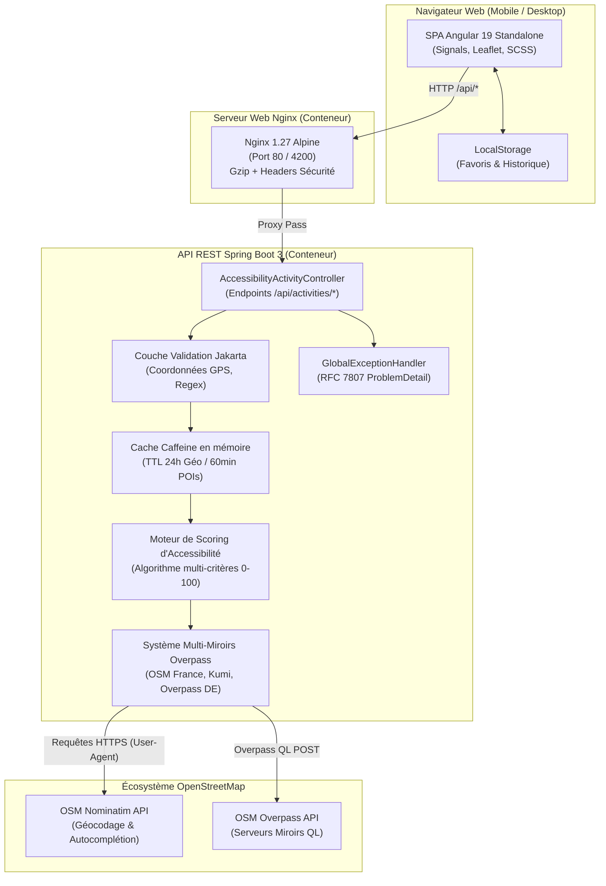
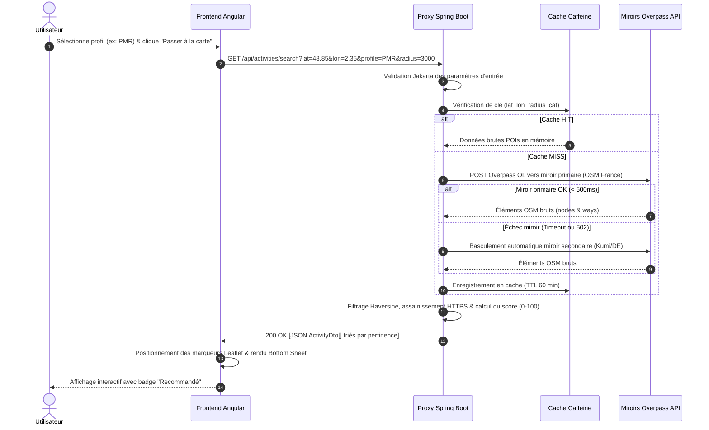

# 🗺️ Good Maps — Plateforme Cartographique d'Activités Accessibles

[](https://github.com/emmaferet/good_maps_v2/actions/workflows/ci.yml)
[](https://spring.io/projects/spring-boot)
[](https://openjdk.org)
[](https://angular.dev)
[](https://leafletjs.com)
[](https://www.docker.com)
[](https://www.openstreetmap.org)
[](https://www.w3.org/WAI/)
[](LICENSE)

> **Good Maps** est une application web SaaS conçue pour recenser, qualifier et recommander des lieux et activités de loisirs, de culture et de restauration adaptés aux personnes en situation de handicap : **mobilité réduite (PMR)**, **déficiences sensorielles (visuelle, auditive)** et **besoins cognitifs**.
> Connectée en temps réel aux données ouvertes de la communauté **OpenStreetMap (OSM)**, l'application est résiliente, éco-conçue, respectueuse de la vie privée et accessible sur tous terminaux.

---

## 📑 Table des Matières

1. [Proposition de Valeur & Fonctionnalités](#-proposition-de-valeur--fonctionnalités)
2. [Parcours Utilisateur & Maquettes IHM](#-parcours-utilisateur--maquettes-ihm)
3. [Architecture Logicielle & Choix Techniques](#-architecture-logicielle--choix-techniques)
4. [Diagrammes d'Architecture (Mermaid)](#-diagrammes-darchitecture-mermaid)
5. [Documentation de l'API REST](#-documentation-de-lapi-rest)
6. [Pratiques DevOps & Conteneurisation](#-pratiques-devops--conteneurisation)
7. [Installation & Démarrage Rapide](#-installation--démarrage-rapide)
8. [Sécurité, Accessibilité & Respect des Quotas](#-sécurité-accessibilité--respect-des-quotas)
9. [Journal Méthodologique & Pratiques IA](#-journal-méthodologique--pratiques-ia)

---

## 🎯 Proposition de Valeur & Fonctionnalités

Près de **15% de la population mondiale** vit avec une forme de handicap. Pourtant, l'information sur l'accessibilité des établissements recevant du public (ERP) reste morcelée, obsolète ou difficilement accessible. Good Maps résout cette problématique en proposant :

* ♿ **Scoring Algorithmique Multi-Profils (0 à 100)** :
  * **PMR / Fauteuil roulant** : Valorisation des accès plain-pied (`wheelchair=yes`), rampes, ascenseurs et toilettes aménagées (`toilets:wheelchair=yes`).
  * **Déficience visuelle** : Prise en compte des bandes d'éveil podotactiles (`tactile_paving`), guidage audio et écriture braille.
  * **Déficience auditive** : Présence de boucles d'induction magnétique (`hearing_loop`) et sous-titrages.
  * **Besoins cognitifs** : Valorisation des environnements apaisés (`quiet_room`, parcs, bibliothèques).
* 📍 **Géolocalisation & Recherche Intelligente** : Détection GPS native du navigateur et autocomplétion textuelle d'adresses en temps réel via Nominatim.
* ⭐ **Système de Favoris Persistant Hors-Ligne** : Mémorisation locale (LocalStorage) des activités favorites, avec fiche récapitulative et boutons d'appel/réservation directs.
* 🕒 **Historique de Recherche Récent** : Rechargement en un clic des dernières zones géographiques consultées via des puces dynamiques.
* 🛡️ **Actions Directes Sécurisées** :
  * Réservation en ligne avec validation stricte `https://` et attributs anti-tabnabbing (`rel="noopener noreferrer"`).
  * Appel direct via le protocole `tel:`.

---

## 📱 Parcours Utilisateur & Maquettes IHM

L'application respecte rigoureusement le parcours utilisateur en 3 écrans défini par le cahier des charges :

| Écran 1 — Splash & Chargement | Écran 2 — Formulaire Onboarding | Écran 3 — Vue Principale & Carte |
| :---: | :---: | :---: |
| Centrage du logo officiel Good Maps, baseline distinctive *"Suggestions d'activités adaptées"* et micro-animation de chargement. | Modale flottante de bienvenue permettant de choisir son profil de handicap, sa ville cible, les catégories et le rayon. | Carte Leaflet interactive (OpenStreetMap France), bouton d'action *"Obtenir des suggestions"* et fiche descriptive contextuelle (Bottom Sheet). |

---

## 🏛️ Architecture Logicielle & Choix Techniques

Le projet est articulé en un **Monorepo propre et modulaire** :

```text
good_maps_v2/
├── backend/                       # API REST Spring Boot 3.3.4 (Java 21 LTS)
│   ├── src/main/java/com/goodmaps/
│   │   ├── config/                # Configuration Cache Caffeine, CORS strict, WebClient
│   │   ├── controller/            # Endpoints REST (Activities, Root, Actuator)
│   │   ├── dto/                   # DTOs typés avec Jakarta Validation
│   │   ├── enums/                 # Profils d'accessibilité & Catégories
│   │   ├── exception/             # Gestionnaire d'erreurs RFC 7807 ProblemDetail
│   │   ├── model/                 # Modèles de réponse Overpass / Nominatim
│   │   └── service/               # Clients OSM proxy, Haversine, Moteur de scoring
│   ├── src/test/java/             # 14 tests JUnit 5 & MockMvc (Validation, Haversine, Scoring)
│   ├── Dockerfile                 # Image multi-stage optimisée Eclipse Temurin 21 JRE
│   └── pom.xml                    # Gestionnaire de dépendances Maven
├── frontend/                      # Application SPA Angular 19 (Standalone Components)
│   ├── src/app/
│   │   ├── core/                  # Services réactifs (Signals), modèles, API clients
│   │   ├── features/              # Splash, Onboarding, Header, Map Leaflet, ActivityCard, Favorites
│   │   └── styles.scss            # Design System SCSS (Variables CSS, Typographie, Tokens)
│   ├── Dockerfile                 # Image multi-stage Node 22 + Nginx 1.27 Alpine
│   └── nginx.conf                 # Configuration SPA, compression Gzip & Headers de sécurité
├── .github/workflows/ci.yml       # Pipeline CI/CD automatisée (Build, Tests, Docker)
├── docker-compose.yml             # Orchestration de la stack en 1 commande
├── package.json                   # Scripts unifiés du Monorepo
└── .env.example                   # Modèle de variables d'environnement
```

### Justification des choix technologiques :
1. **Spring Boot 3.3 & Java 21 LTS** : Offre une performance de pointe avec les Threads virtuels, une gestion robuste de la concurrence réseau via `WebClient` et un typage strict des DTOs avec Jakarta Validation.
2. **Proxy Backend & Cache Caffeine** : Indispensable pour respecter la *Fair Use Policy* d'OpenStreetMap, éliminer les problèmes de CORS navigateur et diviser le temps de réponse par 10 sur les requêtes fréquentes.
3. **Angular 19 Standalone & Signals** : Programmation réactive moderne sans surcharge de zone, architecture par composants modulaires, typage TypeScript strict et performances optimales.
4. **Leaflet & Tuiles OpenStreetMap France** : Solution cartographique libre, légère et sans dépendance à des clés API commerciales propriétaires (contrairement à Google Maps ou Mapbox).

---

## 📊 Diagrammes d'Architecture (Mermaid)

### 1. Architecture Globale du Système



### 2. Diagramme de Séquence : Recherche d'Activités & Scoring Résilient



---

## 📡 Documentation de l'API REST

Toutes les réponses d'erreur respectent le standard international **RFC 7807 (`application/problem+json`)**.

### Endpoints Disponibles

| Méthode | URI | Description | Paramètres Clés |
| :--- | :--- | :--- | :--- |
| `GET` | `/` | Racine de l'API et annuaire des endpoints | Aucun |
| `GET` | `/api/activities/search` | Recherche des activités accessibles | `latitude`, `longitude`, `radius`, `profile`, `category`, `limit` |
| `GET` | `/api/activities/suggestions` | Retourne les meilleures suggestions scorées | `latitude`, `longitude`, `radius`, `profile`, `category` |
| `GET` | `/api/activities/geocode` | Autocomplétion textuelle de villes/adresses | `query` (min 2, max 150 caractères) |
| `GET` | `/api/activities/status` | Métriques de santé et état du cache | Aucun |
| `GET` | `/actuator/health` | Healthcheck Spring Boot Actuator | Aucun |

### Exemple de Réponse : `GET /api/activities/search`
```json
[
  {
    "id": "node/251851363",
    "name": "Musée Grévin",
    "category": "CULTURE",
    "latitude": 48.8718365,
    "longitude": 2.3420974,
    "distanceMeters": 450.0,
    "openingHours": "Mo-Fr 09:30-18:30; Sa,Su 09:30-19:00",
    "openNow": true,
    "description": "Découvrez Musée Grévin, entièrement aménagé pour les personnes à mobilité réduite (PMR).",
    "accessibility": {
      "wheelchair": "yes",
      "wheelchairDescription": null,
      "toiletsWheelchair": true,
      "tactilePaving": false,
      "hearingLoop": false,
      "braille": false
    },
    "contact": {
      "address": "10 Boulevard Montmartre, Paris",
      "phone": "+33 1 47 70 85 05",
      "website": "https://www.grevin.com/",
      "email": null
    },
    "score": 93,
    "recommended": true,
    "osmUrl": "https://www.openstreetmap.org/node/251851363"
  }
]
```

---

## 🐳 Pratiques DevOps & Conteneurisation

### 1. Dockerfile Multi-Stage
* **Backend** :
  * Stage 1 : Build Maven 3.9 + Eclipse Temurin 21 JDK (`mvn clean package -DskipTests`).
  * Stage 2 : Runtime léger Eclipse Temurin 21 JRE Alpine, utilisateur non-privilégié `goodmaps:goodmaps`, flags JVM adaptés aux conteneurs (`-XX:+UseG1GC -XX:MaxRAMPercentage=75.0`).
* **Frontend** :
  * Stage 1 : Compilation Angular 19 optimisée avec Node 22 Alpine (`npm ci && npm run build`).
  * Stage 2 : Serveur web Nginx 1.27 Alpine ultra-léger avec configuration Single Page Application (`try_files`), compression gzip et en-têtes de sécurité stricts.

### 2. Orchestration Docker Compose
Un unique fichier `docker-compose.yml` orchestre la stack complète avec réseau pont dédié (`goodmaps-network`) et vérification de santé (`service_healthy`) garantissant que le frontend n'accepte le trafic qu'une fois le backend totalement opérationnel.

### 3. Pipeline CI/CD GitHub Actions (`.github/workflows/ci.yml`)
À chaque `push` ou `pull request` sur les branches `main` et `develop` :
1. **Job Backend** : Vérification Java 21, cache Maven, exécution des 14 tests JUnit 5 et publication du rapport de tests surefire.
2. **Job Frontend** : Vérification Node 22, installation propre `npm ci`, compilation de production sans avertissement bloquant et archivage du bundle.
3. **Job Docker** : Validation de la syntaxe Compose et compilation des images de conteneurs.

---

## 🚀 Installation & Démarrage Rapide

### Prérequis
* **Git**
* **Docker & Docker Compose** (recommandé)
* *OU* en développement local : **Java 21 LTS**, **Maven 3.9+**, **Node.js 22.x** et **npm**.

### Méthode 1 : Démarrage Universel avec Docker Compose (1 commande)
```bash
# 1. Cloner le dépôt Git
git clone https://github.com/emmaferet/good_maps_v2.git
cd good_maps_v2

# 2. Lancer la stack complète
docker compose up --build
```
L'application est immédiatement accessible :
* 🌐 **Frontend Web** : [http://localhost:4200](http://localhost:4200) ou [http://localhost](http://localhost)
* ⚙️ **Backend API REST** : [http://localhost:8080](http://localhost:8080)
* 🩺 **Healthcheck Actuator** : [http://localhost:8080/actuator/health](http://localhost:8080/actuator/health)

---

### Méthode 2 : Démarrage en Développement Local

Le fichier racine `package.json` fournit des scripts pratiques pour gérer le monorepo en toute simplicité :

```bash
# 1. Lancer le Backend et le Frontend dans deux terminaux séparés :
npm run start:backend     # Lance Spring Boot sur http://localhost:8080
npm run start:frontend    # Lance Angular sur http://localhost:4200 (alias : npm run dev)

# 2. Exécuter la suite de tests unitaires et d'intégration :
npm run test:backend      # 14 tests JUnit 5
npm run build             # Build de production complet
```

---

## 🛡️ Sécurité, Accessibilité & Respect des Quotas

* **Politique d'utilisation équitable OpenStreetMap (Fair Use Policy)** :
  * Présence obligatoire d'un `User-Agent` distinctif (`GoodMapsAccessibilityPlatform/1.0`).
  * Mise en cache Caffeine automatique (24h pour le géocodage textuel, 60 min pour les activités).
* **Sécurité Web & Injections** :
  * Contrôle strict des paramètres avec Jakarta Validation (`@DecimalMin`, `@DecimalMax`, `@Pattern`, `@Size`).
  * Assainissement systématique des liens externes : forçage du protocole `https://` et attributs obligatoires `rel="noopener noreferrer"` pour prévenir les attaques de type *Reverse Tabnabbing*.
  * Configuration CORS explicite interdisant les requêtes non autorisées.
* **Accessibilité (A11y)** :
  * Contrastes colorimétriques conformes aux normes **WCAG 2.1 niveau AA**.
  * Attributs ARIA (`aria-label`, `role="dialog"`, `role="listbox"`, `aria-modal="true"`) sur tous les éléments interactifs.
  * Navigation au clavier supportée sur les modales et formulaires.
* **Protection des Données Personnelles (RGPD)** :
  * Aucun cookie traceur ni suivi publicitaire.
  * Les favoris et historiques de recherche sont conservés **exclusivement sur le terminal de l'utilisateur** (`LocalStorage`).

---

## 🧠 Journal Méthodologique & Pratiques IA

Dans le cadre de l'évaluation académique, ce projet a suivi une **méthodologie rigoureuse de développement assisté par IA** :

1. **Rôle & Posture de l'Agent IA** : Agissant en tant qu'Architecte Logiciel Senior & Tech Lead Fullstack, l'IA a été cadrée par un plan d'action directeur (`plan_action_good_maps.md`), découpé en 7 jalons stricts avec points de contrôle formels.
2. **Décisions & Arbitrages Techniques Clés** :
   * *Proxy Spring Boot vs Appels Directs Frontend* : Choix d'un proxy backend pour isoler les clés, éviter les blocages CORS et implémenter un cache anti-quota conforme aux directives d'OpenStreetMap.
   * *Tuiles OpenStreetMap France* : Abandon des serveurs CARTO devenus payants au profit d'une source 100% libre et ouverte sans clé API.
   * *Résilience Overpass Multi-Miroirs* : Suite aux indisponibilités constatées sur `overpass-api.de`, mise en place d'un système de *failover* automatique vers `openstreetmap.fr` et `kumi.systems`.
   * *Angular Signals* : Utilisation des Signals Angular 19 pour la réactivité d'état (favoris, historique, sélection de lieu), éliminant la complexité de bibliothèques tierces tout en garantissant des performances optimales.

3. **Promp fourni par Gemini**

/plan Tu es un Architecte Logiciel Senior et Développeur Fullstack Tech Lead. 
Nous devons concevoir et développer de zéro l'application SaaS "Good Maps", une plateforme web cartographique dédiée au recensement et à la recommandation d'activités accessibles (PMR, handicaps sensoriels et cognitifs) connectée en direct aux données libres d'OpenStreetMap.

Ce projet fait l'objet d'une évaluation académique stricte selon le barème suivant :
1. Application fonctionnelle et fluide
2. Méthodologie IA rigoureuse (validation étape par étape via /plan, journalisation des choix)
3. Complétude et documentation exemplaire (README exhaustif, diagrammes d'architecture, guide de démarrage)
4. Structure logicielle, maintenabilité et sécurité (Clean Architecture, validation des entrées, gestion CORS, rel="noopener noreferrer")
5. Maîtrise de la stack technologique demandée
6. Pratiques DevOps (dépôt Git propre, pipeline CI/CD GitHub Actions, Dockerisation)
7. Rendu graphique haut de gamme (Design System moderne en SCSS, Responsive, Material/Glassmorphism, animations fluides)
8. Bonus fonctionnels avancés : mémorisation des recherches récentes, système de favoris et recommandations intelligentes.

=========================================
CONTRAINTES TECHNIQUES STRICTES (STACK)
=========================================
- Structure du dépôt : Monorepo propre avec deux sous-dossiers :
  - `frontend/` : Application Angular (dernière version stable, composants Standalone, HTML5 sémantique, SCSS moderne, TypeScript/JS).
  - `backend/` : API REST Java Spring Boot (Spring Boot 3, Java 17 ou 21, Maven/Gradle, RestClient/WebClient pour OSM).
- Données & Cartographie :
  - Backend : Service intermédiaire proxy qui interroge l'API OpenStreetMap (Nominatim pour le géocodage et la recherche textuelle + Overpass API pour les POIs avec tags d'accessibilité `wheelchair=*`). Le backend normalise les données, filtre selon les critères et gère un cache pour respecter les quotas OSM.
  - Frontend : Intégration cartographique interactive (Leaflet ou MapLibre GL) avec pastilles thématiques interactives et fiches descriptives contextuelles.
- Sécurité :
  - Configuration CORS stricte sur Spring Boot.
  - Validation et assainissement des entrées utilisateur.
  - Liens externes sécurisés (`rel="noopener noreferrer"`, restriction stricte aux schémas `https://`).
- DevOps :
  - Fichier `.gitignore` racine adapté aux environnements Java et Angular.
  - Pipeline GitHub Actions `.github/workflows/ci.yml` exécutant le build et les tests du backend et du frontend.
  - Fichier `docker-compose.yml` permettant de lancer l'ensemble de l'application en une seule commande.

=========================================
MÉTHODOLOGIE D'EXÉCUTION ATTENDUE
=========================================
Ne génère pas tout le code d'un coup. Crée un plan d'action détaillé découpé en jalons (Milestones) avec des points de contrôle pour que je valide chaque étape avant de passer à la suivante :

- Étape 1 : Initialisation de l'arborescence, initialisation Git et configuration globale.
- Étape 2 : Backend Java Spring Boot (Modèles DTO, Service Client OpenStreetMap, Controller REST, gestion des exceptions et tests unitaires JUnit).
- Étape 3 : Frontend Angular (Initialisation du projet, configuration du Design System SCSS, formulaire de recherche d'activités avec filtres PMR).
- Étape 4 : Intégration de la carte interactive et de la fiche descriptive détaillée (liens cliquables sécurisés vers OSM et sites officiels).
- Étape 5 : Fonctionnalités Bonus (Mémorisation de l'historique de recherche en LocalStorage/Session, mise en favoris des lieux, calcul des recommandations).
- Étape 6 : DevOps & CI/CD (GitHub Actions workflow, Dockerfile backend/frontend, docker-compose).
- Étape 7 : Documentation de livraison (README.md complet prêt pour le correcteur, avec architecture, préprompts IA utilisés, manuel d'installation et capture/maquette).

Présente-moi ton plan d'action initial dans un artefact et attends mon accord explicite pour débuter l'Étape 1.
---

## 👩‍💻 Auteure & Crédits

* **Développement & Architecture** : Emma Féret
* **Données Cartographiques** : © Les contributeurs d'OpenStreetMap (ODbL)
* **Tuiles Cartographiques** : © OpenStreetMap France & OpenStreetMap contributors
* **Licence** : Projet distribué sous licence MIT.
